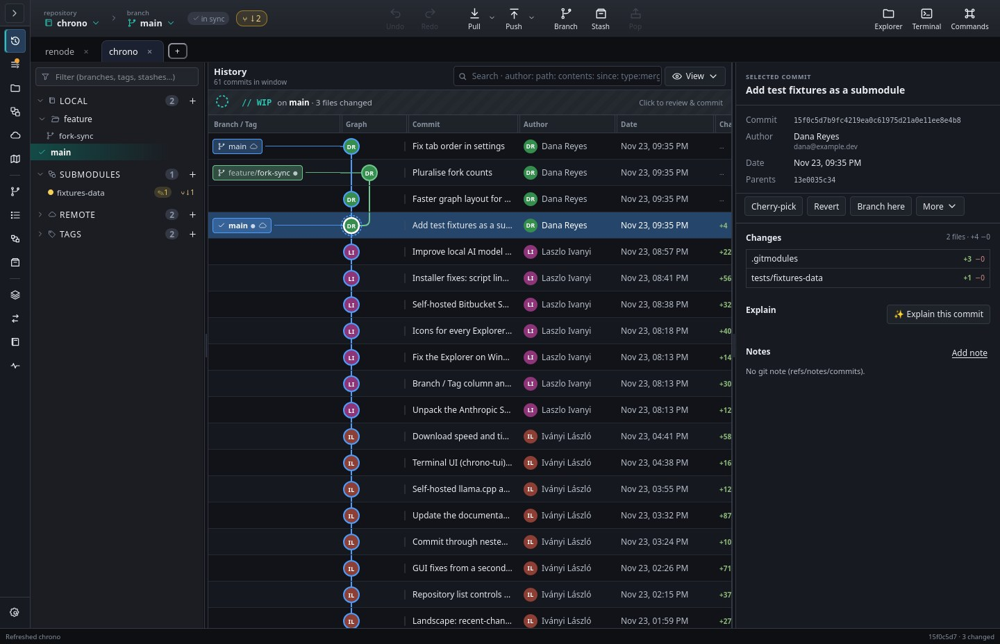
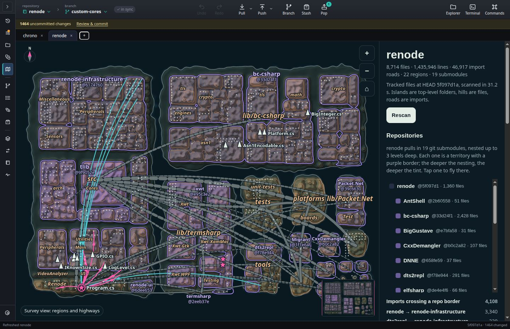
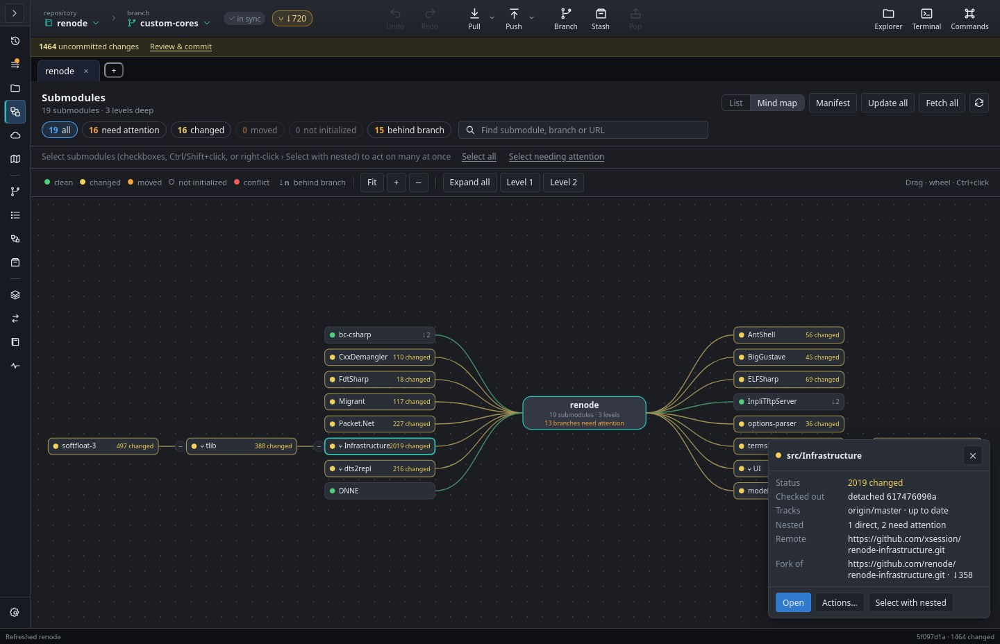
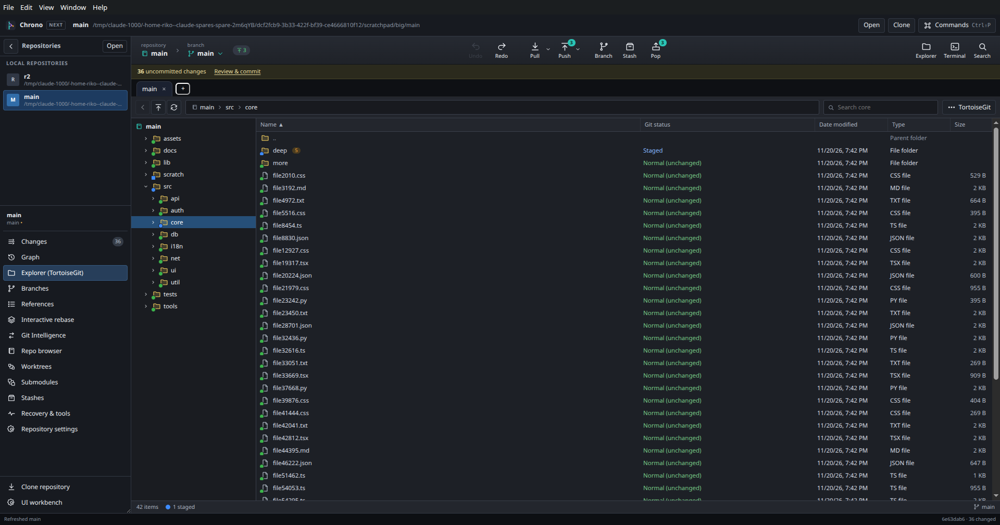
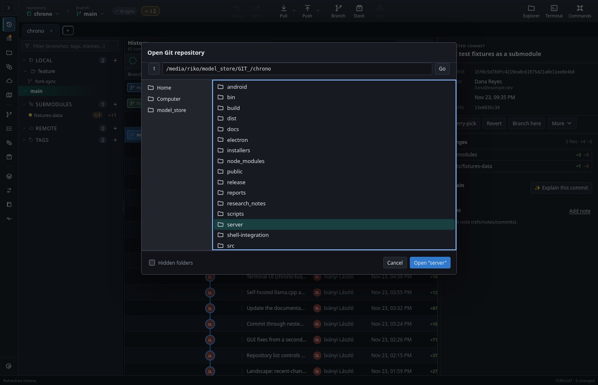
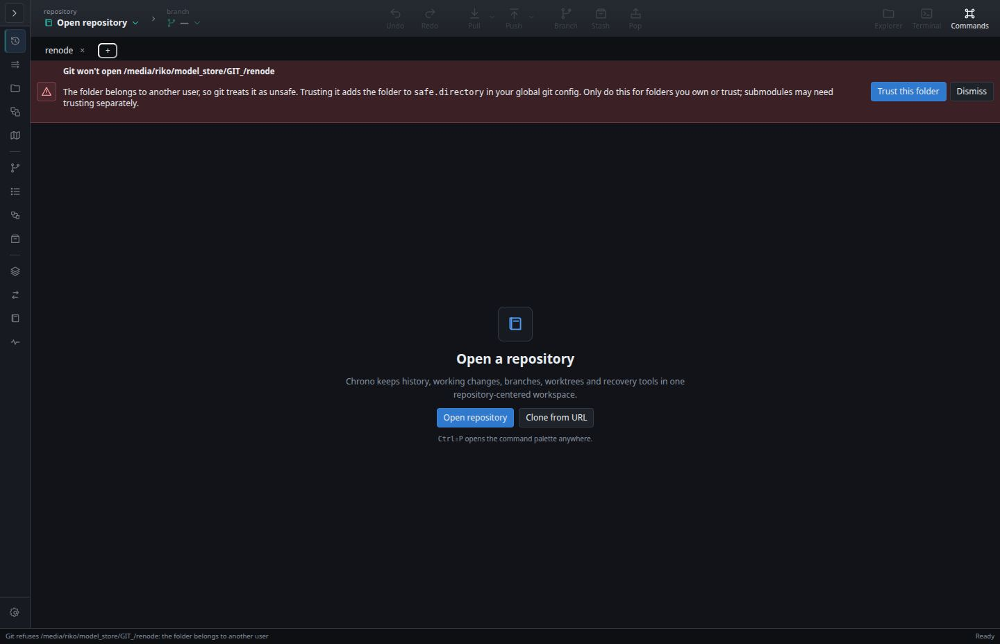
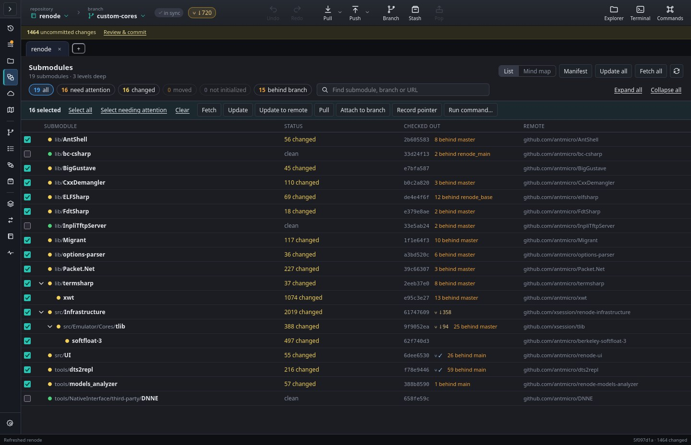

# Chrono Next

A Git client with a web build, an Electron desktop build, and an Android
companion, all driven by one TypeScript codebase (Node HTTP server + React UI).
Rewritten from the original Tauri/Rust stack to pure TypeScript.

| | |
|---|---|
|  |  |
| Graph, with one tab per open repository | [Landscape map](#codebase-landscape-map): the code as terrain |
|  |  |
| [Submodule mind map](#large-multi-repo-trees-submodules) | [TortoiseGit explorer](#tortoisegit-explorer) |

## Stack

- Node.js 22+ (runs the TypeScript backend directly via native type-stripping — no build step for the server)
- React 19 + TypeScript
- Vite (frontend dev server + production build)
- Electron (optional desktop shell)
- Capacitor 7 (optional Android companion)
- Native Git CLI on the server host (all git logic is TypeScript wrappers over `git`)

## Architecture

```
Browser (React 19)  ──WebSocket /api/rpc──────▶  Node server (TypeScript)
                    (fallback: POST /api/<command>)   └──▶ git CLI, one lane per repository
   dev: Vite :1420 proxies /api :1421
   prod: server :1421 serves dist/ directly
```

- API calls share one WebSocket (`server/src/rpc.ts`). Browsers allow only six
  HTTP connections per host, so a slow repository could otherwise stall every
  other tab. Each request has an id and can be cancelled. Plain HTTP POST is
  the fallback when the socket is unavailable.
- Every repository gets its own git lane (`server/src/lib/git.ts`): a bounded
  pool of git processes, so one repository never queues behind another.
  Identical reads that run at the same time share one process, but never
  across a write. Reads for a tab you have left are killed; writes never are.

- `server/` — the full TypeScript backend. Every former Tauri command is now a
  `POST /api/<command>` route (see `server/index.ts` for the route table).
  - `server/src/lib/git.ts` — git CLI wrapper + log/numstat parsers
  - `server/src/backend.ts` — summary, history, status, branches, stage, commit,
    fetch/pull/push, clone, branches, workflows (worktrees, stashes, bisect, …)
  - `server/src/operationState.ts` — merge/rebase/cherry-pick/revert detection + continue/skip/abort
  - `server/src/conflictCenter.ts` — three-way Conflict Center (index stages 1/2/3)
  - `server/src/rebasePlanner.ts` — interactive rebase planner (pick/reword/edit/
    squash/fixup/drop, `--update-refs`, todo injected via GIT_SEQUENCE_EDITOR)
  - `server/src/insights.ts` — search, compare, range-diff review, repository
    health, file/line history, blame, contributors, worktrees
  - `server/src/commitWriter.ts` — local-first staged-diff commit drafting
    with optional loopback Ollama and deterministic offline fallback
  - `server/src/provider.ts` — pull requests (GitHub/GitLab/Gitea/Forgejo)
    with the Git Intelligence pull-request triage tab and remote auto-detection
  - `server/src/workspaces.ts` — workspace persistence (`~/.chrono-next/workspaces.json`)
  - `server/src/submodules.ts` — recursive submodule tree, bulk actions, foreach, manifest
  - `server/src/landscape.ts` — source scan behind the landscape map (parsers in `landscapeParse.ts`; recent changes for the heatmap in `landscapeRecent.ts`)
  - `server/src/folders.ts`, `server/src/trust.ts` — in-app folder picker, `safe.directory` trust
- `src/` — the React UI.
  - `src/graph.ts` — commit-graph layout engine (topological depth + lane
    assignment), unit-tested in `tests/graph-layout.test.ts`.
  - `src/components/CommitGraph.tsx` — History timeline: real branch/merge
    connections, branch-name chips, HEAD marker, filtered-history gaps.
- `electron/` — desktop shell. Spawns the backend itself on a random port in
  14210-14310 (no separate server needed).
- `android/` — Capacitor companion. A client that connects to a running Chrono
  server over HTTPS (enter its address via the Backend button in the app).

## Prerequisites

- Node.js 22+
- Git 2.38+ recommended (required for rebase `--update-refs`)
- Electron desktop: nothing extra (the starter installs it)
- Android companion: JDK 17+ and the Android SDK

The Git Intelligence view includes offline history search/compare/range review,
repository-health, file history/blame/contributor/activity views plus a
provider-aware pull-request triage surface. Range review compares two patch
series versions from a common base using Git's native `range-diff`; health
metrics are read-only until an explicit object scan is requested.
It detects SSH and HTTPS remotes, supports GitHub, GitLab, Gitea and Forgejo,
and keeps entered provider tokens in memory only. File history now includes a
revision viewer with previous/next navigation, root-revision previews and
unified two-revision diffs. The Changes view also has a local commit-writing
assistant: it can use Ollama on `127.0.0.1:11434` when available and otherwise
creates a conservative offline draft from the staged index. Drafts support
Conventional Commit or plain imperative style plus safe `#123`/`PROJECT-123`
issue references. The Worktrees view reports dirty-file and conflict counts
for every linked checkout and can open a selected worktree. Changes also
supports selecting individual unstaged text hunks for the index, while commit
quality checks provide live subject/style/reference feedback without blocking
manual commits. Set
`CHRONO_LOCAL_AI_MODEL` to change the default model (`qwen2.5:3b`).

History also supports persisted graph scope (all refs, current branch, or a
local branch) and guarded reset-to-selected-commit actions for soft, mixed and
hard reset modes. The History graph also provides persisted per-reference
visibility controls for hiding or soloing local and remote branches. Large
history windows keep their complete graph layout and page navigation while
mounting only an overscanned viewport of rows, so thousands of commits remain
comfortable to browse.

## GitKraken-style workspace

The Graph view follows GitKraken's layout:

- **Toolbar:** repository and branch pickers, Undo / Redo, Pull▾ (Fetch All, fast-forward if possible, fast-forward only, rebase; the checked mode becomes the default), Push▾ (set upstream, with tags, force-with-lease), Branch, Stash, Pop, Explorer, Terminal and Search.
- **Left panel:** LOCAL (folder-grouped, ahead/behind counts), REMOTE (per remote, add/edit/prune/remove), WORKTREES, STASHES (shows a stash's files inline), TAGS, SUBMODULES and PULL REQUESTS. It has a filter and full context menus. Drag a branch onto another branch to merge, rebase, fast-forward or reset it.
- **Line-level staging:** clicking a file in the WIP panel opens its diff with *Unstaged* and *Staged* tabs. Click, drag or Shift+click to select lines, then *Stage lines* / *Unstage lines* / *Discard lines*, or act on a whole hunk. Keys: S stages, U unstages, Esc clears, Ctrl+A selects all. Chrono builds a patch from just the selected lines and applies it with `git apply --recount`. This also works for untracked files and files without a trailing newline, and a diff that changed meanwhile is refused.
- **`// WIP` node:** sits above the newest commit. Clicking it opens the commit panel: Unstaged and Staged lists (path or tree view), stage/unstage all, per-file menus (discard, stash, ignore, history, show in Explorer), a summary with a 72-character counter, a description, amend, sign-off and AI draft. Ctrl+Enter commits.
- **Undo / Redo** (Ctrl+Z / Ctrl+Y): the server records the effect of each Chrono action on branches and HEAD (commit, checkout, branch create/delete, reset, merge, pull, cherry-pick, revert). Undo restores the previous state, using `reset --soft` for commits and `reset --keep` otherwise. Redo re-applies it. Both refuse to run if the repository was changed outside Chrono in the meantime. The journal is saved to `undo-journal.json` in the config directory, so it survives server restarts.
- **Compare two commits:** select a commit, then Ctrl+click (⌘+click) another. The right panel lists the files that differ between them and clicking a file shows its diff over the graph.
- **Author avatars:** each graph row shows the author's initials on a colour derived from their email.

## Opening repositories and tabs

- **Folder picker:** Open, Open in new tab, Clone → Browse… and Settings → Apply to folder use
  Chrono's own picker. It lists folders through the server, so it works in the
  web build and on a remote server too. Folders that are Git repositories carry
  a `git` badge. You can type a path or `~`, filter by typing, use the arrow
  keys and Backspace, show hidden folders, and jump to Home, Computer and
  mounted drives. The desktop app also offers the system dialog.
- **Repositories owned by another user:** git refuses these ("dubious
  ownership"), which is common on shared or NTFS drives. Chrono shows a banner
  that explains why. *Trust this folder* adds it to `safe.directory` in your
  global git config; submodules may need trusting separately.
- **Tabs:** each open repository is a tab. Switching shows the tab's last state
  at once and refreshes it in the background ("Updating…" in the status bar),
  so even a repository whose `git status` takes a minute switches instantly.
  Drag a tab to reorder it (or press Ctrl+Shift+←/→). Close it with its ×, a
  middle click, Delete, or the right-click menu, which also has *Close other tabs*.
- **Local repositories** (the expanded sidebar): clicking one opens it in a
  tab. Drag entries to reorder them (or Alt+↑/↓), remove one with its ×, a
  middle click, Delete or the right-click menu, and empty the list with
  *Clear* (click twice to confirm). Only the list changes; nothing on disk is
  touched. Every repository you open is added to it.
- **Live changes:** the server watches each open repository, so edits made in an
  editor, a terminal or another tool show in the Changes list and the graph's
  WIP row within about 0.1–0.2 s. Commits, checkouts, fetches and rebases made
  elsewhere also reload the graph. Only folders git cares about are watched, so
  ignored trees like `node_modules` cost nothing. If the system runs out of
  inotify watches (`fs.inotify.max_user_watches`), Chrono checks `git status`
  once a second instead.
- **Resizable layout:** drag the edges of the branches panel, the commit details
  panel, the Explorer folder tree and every column header (Graph, Commit, Author,
  Date, Changes, SHA, and the Explorer list columns). Double-click an edge to
  restore its default. Widths are remembered.

| | |
|---|---|
|  |  |

## Large multi-repo trees (submodules)

The **Submodules** view is built for trees like Renode: dozens of submodules,
nested several levels deep.

- **List or mind map.** The list shows every submodule with its status,
  checked-out commit, tracking branch and remote. The mind map puts the
  superproject in the middle and balances top-level submodules left and right
  by size; edges and nodes are coloured by state. Branches can be collapsed,
  and a badge shows how many nested submodules need attention. Big trees start
  folded below level 1. Click a node for its details: status, checkout,
  tracking branch, nesting and remote.
- **Filters:** all, needs attention, changed, moved, not initialised and
  *behind branch*: submodules whose tracking branch (`branch` in `.gitmodules`,
  else `origin/HEAD`) has commits the pinned commit lacks.
- **Bulk actions on a selection** (checkboxes, Ctrl/Shift+click, *Select with
  nested*, *Select needing attention*): Fetch, Update, Update to remote, Pull,
  Attach to branch (moves a detached HEAD onto the matching branch),
  Record pointer, and *Run command…*, a `foreach` that runs a shell command in
  each submodule with `$sm_path`, `$sha1` and `$toplevel` set. They run one
  nesting level at a time, several at once. Results list per submodule, with
  *Select the ones not done* to retry.
- **Manifest:** export every submodule's path, URL, commit and branch as JSON
  (copy or download), to record or reproduce a tree's exact state.

| | |
|---|---|
|  |  |

## Codebase landscape map

**Landscape map** in the sidebar (or *Open codebase landscape map* in the
command palette) draws the repository as terrain, so you can find your way
around it the way you find your way around a place:

- Top-level folders are islands and the sea is the boundary between them.
  Files are hills: height is the amount of code, or how many files depend on
  it. Imports are roads, and highways join regions.
- Submodules are territories with a purple border; nested ones are tinted
  deeper. Towers mark the most-imported files. Stars mark every entry point
  (`main`, `index`, `server`, `cli`… and scripts in `scripts/`, `bin/`,
  `tools/` that nothing imports); hollow green stars mark test entry points,
  the test files nothing imports.
- **Heatmap** (under the map's options) overlays what changed recently: the
  glow is how recently and how often a file was committed, within the last
  day, week, month, 3 months or year, and a ring marks uncommitted edits,
  submodules included. The strength slider sets the glow and dims the rest of
  the map. It updates live as files change.
- **Explore** a file to see its roads in and out. **Route** gives directions
  between two files along import roads. **Walk** visits the landmarks in a
  fixed order, like a memory palace. **Runtime** overlays a profiler trace
  (Speedscope, `.cpuprofile` or folded stacks) as heat and moving traffic.
  Fog of war shows only where you have been. Your trail is saved per
  repository.
- On a selected file, *Show in Explorer*, *History* and *Blame* open it in
  Chrono. A file inside a submodule opens in that submodule's own tab.

The server reads tracked files only, submodules included, so ignored build
output stays off the map. It detects imports in about 15 languages, plus
Renode `.repl`/`.resc`/`.robot` files. Up to 12,000 files are mapped. The scan
is cached per commit in memory and under `CHRONO_CONFIG_DIR/landscape/`;
*Rescan* reads the working tree again. Renode (8,700 files, 19 submodules)
takes about half a minute the first time on a slow drive, then opens
instantly.

The map is a self-contained page (`public/landscape/index.html`) shown in a
sandboxed frame: it cannot reach Chrono or the network, loads nothing from the
internet, and only exchanges messages with the view around it.

## TortoiseGit explorer

The **Explorer (TortoiseGit)** view (Ctrl+4) is a Windows-Explorer-style browser of the working copy. It shows a folder tree, sortable details and TortoiseGit icon overlays (normal, modified, staged, added, deleted, conflicted, unversioned, ignored, plus assume-unchanged and skip-worktree flags). Right-clicking an item, a selection or the empty background opens the TortoiseGit shell menu:

- **Top level:** Open, Open containing folder, Git terminal here, Git Sync…, Git Commit -> "branch"…, Git Diff / Add / Resolve (when relevant), Copy path, New folder/file, Properties.
- **TortoiseGit ▸:** Pull, Fetch, Push · Diff, Diff with previous version, Diff later / Diff two files · Show log, Show Reflog, Browse References, Revision graph, Repo-browser, Check for modifications, Blame · Resolve (mine/theirs), Revert…, Clean up… · Switch/Checkout, Merge, Create Branch, Create Tag, Export · Rebase, Stash Save/Pop/List, Bisect · Add…, Add to ignore list (by name or extension, local or root .gitignore), Delete and add to ignore list, Delete (keep local), Rename (git mv), Delete, Revert to revision · Index flags (assume-unchanged, skip-worktree) · LFS (lock, unlock, track, locks, pull) · Submodule Update · Create Patch, Apply Patch · Settings, About.

Keyboard: F5 refresh, F2 rename, Del delete, Backspace up a folder, Ctrl+A select all, Shift+F10 opens the menu. "Open" and "Open containing folder" run on the server host, so they only work when Chrono listens on localhost.

## Trust, safety and workflow features

These features come from the roadmap in `reports/Git client feature gap analysis.md`. Most settings live in **Repository settings** in the sidebar, and every action is also in the command palette.

- **Commit signing:** the graph shows a badge on each signed commit (verified, unknown key, expired, revoked, bad). Signatures are checked only for rows on screen. Settings has a setup screen for GPG, SSH and X.509 signing (`gpg.format`, `user.signingkey`, `commit.gpgSign`, `tag.gpgSign`, `gpg.ssh.allowedSignersFile`).
- **Identity profiles:** reusable sets of name, email and signing key. A profile applies to one repository (through a local `include.path`) or to every repository under a folder (through a global `includeIf "gitdir:"`). Switching profiles never rewrites the repository's own config.
- **Large-repo performance:** one click applies Scalar-style settings: a commit-graph with changed-path filters, the multi-pack index, the untracked cache, index v4 and background maintenance. A status panel shows the commit-graph, maintenance, fsmonitor, untracked cache and loose objects. Individual actions are also available, including `fsmonitor` where git supports it.
- **Search operators:** the graph search box accepts `author:`, `committer:`, `message:`, `-message:`, `path:`, `contents:` (`-G`), `since:`, `until:`, `type:merge|nomerge`, `sha:` and `ref:`, with quoted values allowed. Searches cover all history, not only the loaded window.
- **Git hooks:** Settings lists, shows and enables or disables hooks. If `pre-commit` or `commit-msg` rejects a commit, Chrono shows the hook's output and offers an explicit "Commit anyway (--no-verify)".
- **Commit message helpers:**
  - Templates: insert one with `t:` in the summary field or from the template menu. git's `commit.template` is included automatically.
  - Co-authors: pick contributors to add `Co-authored-by:` lines.
  - The AI draft follows `AGENTS.md` and `.github/copilot-instructions.md` if the repository has them.
- **Issue links:** issue IDs in commit messages become links, using per-repository regex → URL rules stored in `.git/config` (`chrono.autolink`).
- **Fork point:** the graph's *Fork* highlight mode dims history from before the current branch left its base.
- **Diff options:** ignore whitespace, choose the diff algorithm, wrap long lines, and restore a file from a commit (or from the commit before it) using the right-click menu in the commit inspector.
- **Conflict prediction:** merge, rebase, cherry-pick, revert and drag-and-drop first run a `git merge-tree` dry run. Files that would conflict are listed before anything touches the working tree.
- **Branch cleanup:** finds branches that were merged, squash- or rebase-merged, whose upstream was deleted, or that are stale. They can be archived under `refs/chrono/archive` (restorable from Settings) or deleted, and both can be undone.
- **Stacked branches:** each branch can have a parent, stored as `branch.<name>.chronoParent`. "Create stacked branch" makes a new branch on top of another. "Restack" rebases the whole stack with `rebase --update-refs` from its tip. The parent is also the default base for pull requests.
- **Pull requests and CI:**
  - Create GitHub pull requests, GitLab merge requests and Gitea/Forgejo pull requests, with the repository's PR template, a preview of the commits and diffstat, and a generated description.
  - The commit inspector shows CI check status and can re-run GitHub Actions jobs or GitLab pipelines.
  - Provider tokens are kept for the browser session only. For GitHub Enterprise or self-hosted servers, set the API base in the pull-request dialog; Chrono remembers it per host.
- **Custom commands:** your own commands, defined as one argument per line, appear in the palette and on the commit, branch and file menus. They support `$REPO`, `$BRANCH`, `$SHA`, `$FILES` and `$PARAM_name`, plus parameter dialogs. Each variable is substituted into a single argument, so values never pass through a shell. Commands other than git only run when the server listens on localhost.
- **Image diff:** side by side, swipe, onion skin and pixel difference, with Git LFS content fetched through `git cat-file --filters`.
- **Agent sessions:** creates a worktree on a new branch, opens a terminal there and starts an agent CLI (Claude Code, Codex, Gemini, Aider or any command). The worktree's uncommitted work shows as its own WIP entry above the graph.
- **Git-flow:** initialise, then start and finish features, releases and hotfixes. Finishing uses `merge --no-ff` and creates the tag, signed when tag signing is on. It is all done with plain git commands and can be undone.
- **Explain:** explains a commit, a branch or your working changes in plain language. It uses local Ollama when it is running and otherwise falls back to a deterministic summary.
- **Other:** git notes on commits, sparse-checkout controls, and clone options for shallow, blobless, treeless, single-branch and sparse clones.
- **Accessibility:**
  - A colour-blind-safe graph palette, distinct node shapes per lane, high contrast and reduced motion.
  - F7 / Shift+F7 move between diff hunks.
  - Commit rows have descriptive screen-reader labels, and status messages are announced through `aria-live`.
- **Live output:** commits, fetch, pull and push stream their output (hook messages, transfer progress) into a small console while they run. It appears only if an operation takes longer than a moment, and stays open if the operation fails.
- **Treemap:** Git Intelligence → Treemap shows the repository as a squarified treemap. Area is file size or recent churn, colour is churn intensity, and clicking a folder drills into it.
- **Notifications:** an optional desktop notification when a fetch, pull, push, rebase, clone or CI check finishes while Chrono is in the background.

### Right-click menu in your file manager

Like TortoiseGit, Chrono can add a **Chrono** submenu to the operating system's file manager. Right-click files or folders and choose an action: Git Commit…, Show log, Diff, Diff with previous version, Blame, Check for modifications, Revert…, Add…, Resolve, Clean up…, Stash save…, Create patch…, Git Sync…, Properties, Open in Chrono Explorer, Show in Chrono graph, or Open Git terminal here. Chrono opens the repository that contains the selection and runs the action on exactly those files.

| Platform | Install | Remove |
|---|---|---|
| Windows Explorer | `powershell -ExecutionPolicy Bypass -File shell-integration\windows\install-context-menu.ps1` | add `-Uninstall` |
| Linux: Nautilus, Caja, Nemo, Dolphin | `sh shell-integration/linux/install.sh` | `--uninstall` |
| macOS Finder | Automator Quick Actions, see `shell-integration/macos/README.md` | |

- **Windows:** entries are written under `HKCU` only, so no administrator rights are needed. On Windows 11 they appear under *Show more options*. Pass `-ExePath` if Chrono isn't installed in the default per-user location.
- **How actions reach Chrono:** the desktop app is started as `Chrono --tgit=<action> <paths…>` and turns that into the deep link `chrono://tgit?action=<action>&path=<absolute path>`. The link also works on its own, and for the web build as `http://<server>/?chrono=tgit&action=…&path=…`.
- **Linux helper:** menus call `chrono-open`. It uses `$CHRONO_BIN` (or `chrono` on PATH) when set, otherwise `$CHRONO_WEB_URL` for the web build, otherwise the registered `chrono://` handler.
- **Not included:** TortoiseGit's status icons on the file manager's own icons need a native shell extension, which this doesn't provide. Chrono's Explorer view shows the same status icons instead.

## Install

### Installer scripts (desktop)

The installer scripts build Chrono from this checkout and install it like a normal app. At the end they print the installed version.

```bash
./install-linux.sh                     # build + install (.deb on Debian/Ubuntu, .rpm on Fedora/openSUSE, AppImage elsewhere)
./install-linux.sh --user              # per-user AppImage in ~/.local, no sudo
./install-linux.sh --release v1.0.0    # download a GitHub release instead of building (latest if no tag)
./install-linux.sh --file Chrono-1.0.0-linux-amd64.deb
./install-linux.sh --uninstall
```

```bat
install-windows.bat                    :: build + install per user (%LOCALAPPDATA%\Programs\Chrono), no admin
install-windows.bat --release v1.0.0   :: download a GitHub release instead of building
install-windows.bat --file Chrono-Setup-1.0.0-x64.exe
install-windows.bat --dir D:\Apps\Chrono :: install on another drive (needs about 400 MB free)
install-windows.bat --uninstall
```

- **Building needs** Node.js 22+ and git. `--release` and `--file` need neither.
- **The .deb/.rpm route** asks for sudo once. It replaces an earlier per-user AppImage install, so only one Chrono remains.
- **On Windows,** close Chrono before installing. The setup runs silently and adds the Start menu and desktop shortcuts, the `chrono://` handler and the Explorer **Chrono** menu.
- **Settings are kept** when you uninstall.

### Packages

Download from the [GitHub Releases](https://github.com/xsession/chrono/releases) page and verify with `SHA256SUMS.txt`:

| Platform | Package | Notes |
|---|---|---|
| Windows | `Chrono-Setup-<v>-x64.exe` / `-arm64.exe` | Per-user install, no admin needed. Adds the Explorer **Chrono** right-click menu, removed on uninstall. A portable `.exe` is also available. |
| macOS | `Chrono-<v>-mac-x64.dmg` / `-arm64.dmg` | Unsigned builds: right-click → Open the first time. |
| Debian / Ubuntu | `sudo apt install ./Chrono-<v>-linux-amd64.deb` | Installs `chrono` and `chrono-open` and the Dolphin and Nemo menus. For Nautilus/Caja run `/opt/Chrono/resources/shell-integration/linux/install.sh`. |
| Fedora / openSUSE | `sudo dnf install ./Chrono-<v>-linux-x86_64.rpm` | Same as `.deb`. |
| Any Linux | `Chrono-<v>-linux-x86_64.AppImage` | `chmod +x` and run. |
| Server (Docker) | `docker run -d -p 127.0.0.1:1421:1421 -e CHRONO_API_TOKEN=$(openssl rand -hex 24) -v ~/src:/repos ghcr.io/xsession/chrono` | Open http://localhost:1421 and enter the token. Repositories are under `/repos`. `installers/server/docker-compose.yml` has a Compose version. |
| Server (Node) | `chrono-server-<v>.tar.gz` | `npm ci --omit=dev`, then `installers/server/install-linux-service.sh` (systemd user service) or `install-windows-service.ps1` (logon task). |
| Android | `Chrono-<v>-android.apk` | Companion client for a Chrono server reached over HTTPS. |

The server refuses to listen on a non-loopback address without `CHRONO_API_TOKEN`, unless you set `CHRONO_ALLOW_INSECURE_REMOTE=1`. Maintainers: see [docs/RELEASING.md](docs/RELEASING.md) for CI/CD and signing.

## Run (web)

Easiest — the launchers install Node.js 22+ if it is missing, install npm
dependencies, build and start:

```bash
run.bat          # Windows: opens http://localhost:1421
./run.sh         # Linux/macOS: opens http://localhost:1421
# add --check to only install + build without starting
```

Manually:

```bash
npm install
npm run typecheck
npm run dev            # API server :1421 + Vite dev server :1420
# open http://localhost:1420
```

## Desktop (Electron)

The starter installs Node 22+ if missing, builds, and launches the desktop app:

```bash
starter-electron.bat                                  # build + launch (Windows)
./starter-electron.sh                                 # build + launch (Linux/macOS)
# --check    install + build only, do not launch
# --packager build installers into release/
```

The backend starts inside the app on a port in 14210-14310 — no other process
needed.

## Android (companion)

The starter installs Node 22+, JDK 17+ and the Android SDK as needed, then
builds the debug APK:

```bash
starter-android.bat            # build + APK (Windows)
./starter-android.sh           # build + APK (Linux/macOS)
# --check    install + build only, do not build the APK
# --open     open the project in Android Studio
```

Output: `android/app/build/outputs/apk/debug/app-debug.apk`. The companion is a
client: run a Chrono server (web build) over HTTPS, then enter its address in
the app's Backend dialog.

## Production build (web)

```bash
npm run build          # typecheck + vite build -> dist/
npm start              # API server on :1421 also serves dist/
# open http://localhost:1421
```

Security: the server can run git, custom commands and a terminal, so it refuses:
- requests whose `Origin` is a different web site, including cross-site WebSocket connections to the terminal;
- requests whose `Host` isn't a loopback name while the server is bound to loopback, which blocks DNS rebinding;
- API POSTs that aren't `Content-Type: application/json`.

Set `CHRONO_API_TOKEN` to serve other machines. The Android companion then sends the token, also for the terminal. `CHRONO_DEV_ORIGINS` adds extra allowed development origins.

Environment: `CHRONO_PORT` (default 1421), `CHRONO_HOST` (default 127.0.0.1),
`CHRONO_CONFIG_DIR` (default `~/.chrono-next`).

## Tests

```bash
npm run test:markers   # pure TS unit tests (conflict marker parsing)
npm run test:graph     # commit-graph layout engine unit tests
npm run test:git       # shell smoke tests against real temp Git repositories
npm run test:api       # boots the API server and exercises every /api route
npm run test:ui-contract # verifies every visible view/control remains wired
npm run test:lines     # line-level stage/unstage/discard edge cases
npm run test:roadmap   # signing/hooks/stacks/cleanup/git-flow/custom-command smoke test
npm run test:submodules # submodule tree, bulk actions, foreach and manifest
npm run test:trust     # dubious-ownership detection and safe.directory trust
npm run test:folders   # folder picker listing; no browser prompt dialogs
npm run test:watch     # live changes: edits, commits and branch moves reported within one second
npm run test:lanes     # per-repository git lanes: sharing, isolation, cancelling
npm run test:landscape # landscape scan and the embedded map page
npm run test:all       # everything above
```

The shell smoke tests create temporary Git repositories and do not modify your own repositories.

## Notes

- Folders are picked with Chrono's own picker, which lists folders on the
  server host (where the repositories are). The Electron build also offers the
  system dialog.
- Clone/fetch/push accept optional username+token in the request for HTTPS
  credentials (embedded in the clone URL); otherwise the server's git
  credential helpers are used.
- The Android companion requires the Chrono server to be reachable over HTTPS
  (Capacitor uses an https scheme and disallows mixed content).
