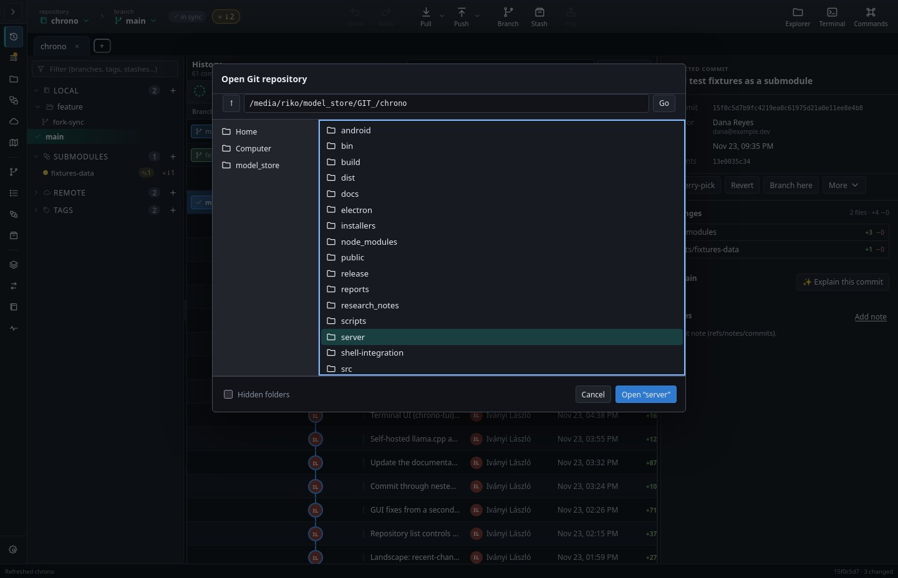
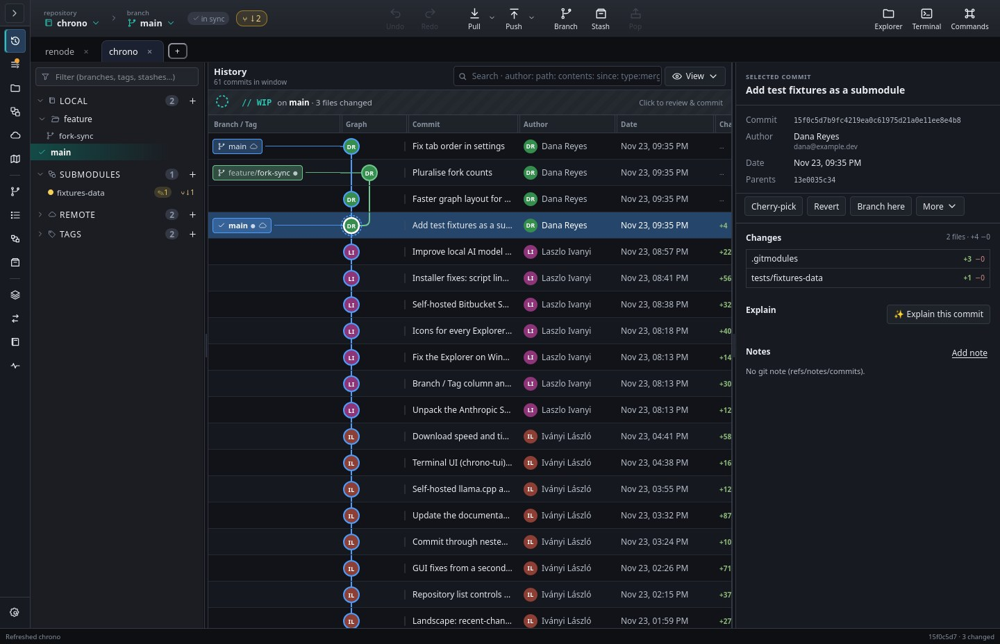
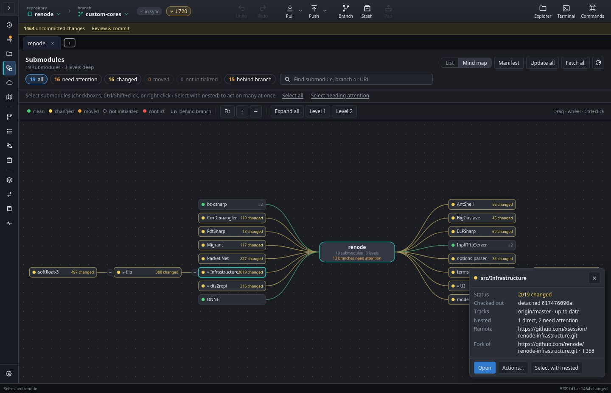
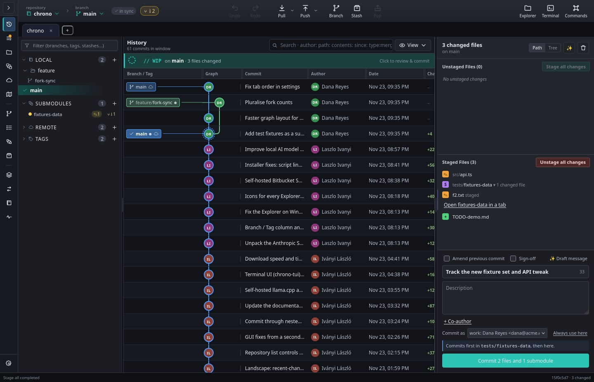
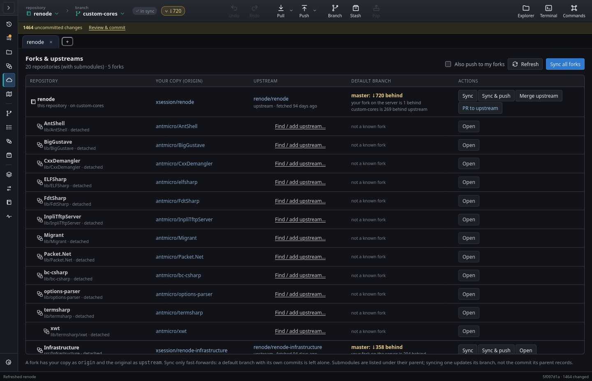
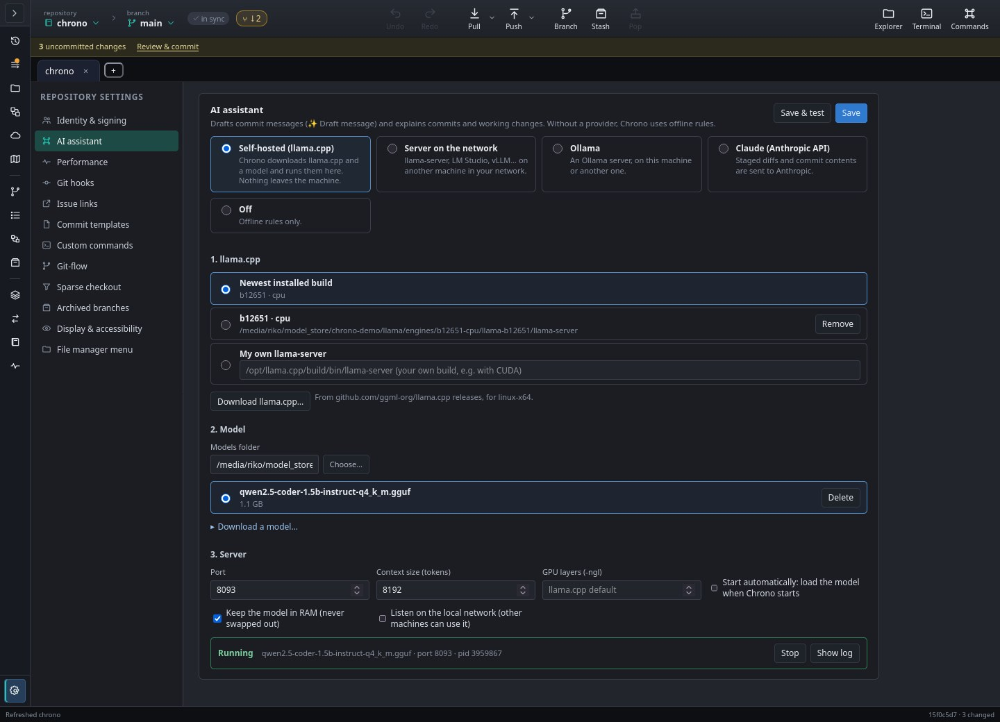
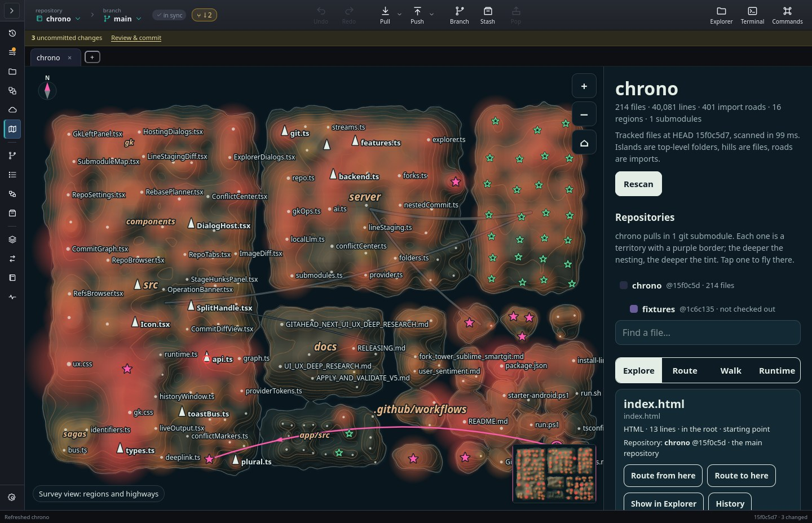
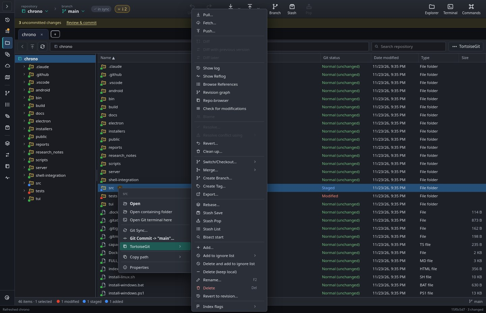
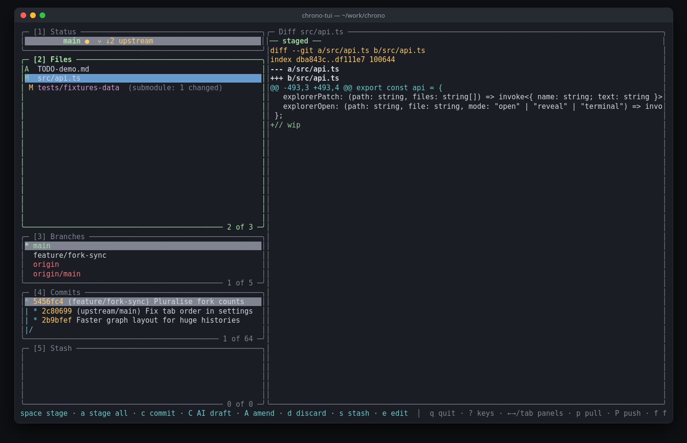

# Chrono tutorial

This tutorial walks through Chrono from the first start to its advanced
features, on a practice repository you build yourself in a minute. Every step
says what to click or press and what you should see. For the reference of
every option see the [README](../README.md); for how things work inside, see
[Theory of operation](THEORY_OF_OPERATION.md).

Contents:

1. [Set up a practice repository](#1-set-up-a-practice-repository)
2. [Start Chrono](#2-start-chrono)
3. [Open repositories and tabs](#3-open-repositories-and-tabs)
4. [Read the graph](#4-read-the-graph)
5. [Stage and commit](#5-stage-and-commit)
6. [Undo and redo](#6-undo-and-redo)
7. [Branches, merges and rebases](#7-branches-merges-and-rebases)
8. [Pull, push and live output](#8-pull-push-and-live-output)
9. [Submodules](#9-submodules)
10. [Commit through submodules](#10-commit-through-submodules)
11. [Several git identities](#11-several-git-identities)
12. [Forks and upstreams](#12-forks-and-upstreams)
13. [The AI assistant](#13-the-ai-assistant)
14. [The landscape map and its heatmap](#14-the-landscape-map-and-its-heatmap)
15. [The TortoiseGit explorer and your file manager](#15-the-tortoisegit-explorer-and-your-file-manager)
16. [Pull requests and CI](#16-pull-requests-and-ci)
17. [The terminal UI](#17-the-terminal-ui)
18. [More workflows](#18-more-workflows)

---

## 1. Set up a practice repository

The practice setup mirrors a common situation: an original project (`acme`),
your fork of it (`you`), and a library that is also a submodule and also
forked. Everything is local; nothing touches the network. Run this in a
terminal (Linux, macOS, or Git Bash on Windows):

```bash
mkdir -p ~/chrono-practice && cd ~/chrono-practice
git config --global protocol.file.allow always   # local submodule URLs (needed once)

# the original library and your fork of it
git init -q acme/lib && (cd acme/lib && echo "v1" > lib.txt && git add . && git commit -qm "Library v1")
git clone -q --bare acme/lib you/lib.git

# the original application, which uses your fork of the library as a submodule
git init -q acme/app && cd acme/app
echo "# App" > README.md && mkdir src && echo "console.log('hi')" > src/main.js
git add . && git commit -qm "First version"
git submodule add -q ~/chrono-practice/you/lib.git lib && git commit -qm "Add the library"
cd ~/chrono-practice

# your fork of the application, and your working copy of it
git clone -q --bare acme/app you/app.git
git clone -q --recurse-submodules you/app.git work
cd work
git remote add upstream ~/chrono-practice/acme/app
git -C lib switch -q main 2>/dev/null || git -C lib switch -q master
git -C lib remote add upstream ~/chrono-practice/acme/lib

# the original project moves on without you
(cd ../acme/app && echo "Faster start" >> README.md && git commit -qam "Start faster")
(cd ../acme/lib && echo "v2" > lib.txt && git commit -qam "Library v2")
```

`~/chrono-practice/work` is the repository you will open. It has a fork
(`origin` is yours, `upstream` is the original), a submodule that is a fork
too, and both are behind their originals.

## 2. Start Chrono

Pick one way to run it:

| You want | Run | Then |
|---|---|---|
| The desktop app | `./starter-electron.sh` (or `starter-electron.bat`), or install it with `./install-linux.sh` / `install-windows.ps1` | A window opens |
| The web build | `./run.sh` (or `run.bat`) | Open <http://localhost:1421> |
| Development | `npm install && npm run dev` | Open <http://localhost:1420> |
| Only a terminal | `npm run tui -- ~/chrono-practice/work`, or `chrono-tui` after installing | See [section 17](#17-the-terminal-ui) |

All of them use the same backend, so everything you do in one is visible in
the others.

Two keys work everywhere: **Ctrl+P** (or Ctrl+Shift+P) opens the command
palette, which can run every action by name, and **Ctrl+K** lists the
keyboard shortcuts.

## 3. Open repositories and tabs

1. Click **Open repository**. Chrono's own folder picker opens. Type
   `~/chrono-practice/work` in the path box and press Enter, or walk there
   with the arrow keys; folders that are git repositories carry a `git`
   badge. Click **Open "work"**.
2. A tab named `work` appears. Click **+** next to it and open
   `~/chrono-practice/acme/app` as well. Each repository is a tab; switching
   is instant because a tab shows its last state while it refreshes.
3. Drag a tab to reorder it (or Ctrl+Shift+←/→). Middle-click a tab to close
   it, and reopen it from **Local repositories** in the expanded sidebar (the
   `>` button at the top left). That list can be reordered by dragging
   (Alt+↑/↓), and entries can be removed or the whole list cleared; files on
   disk are never touched.
4. If you ever open a repository that belongs to another user (a USB drive, a
   folder created by root), git refuses it and Chrono shows a red banner.
   **Trust this folder** adds it to `safe.directory` in your global git
   config. Only do that for folders you trust.



## 4. Read the graph

Click **Graph** in the left rail (Ctrl+2).

- **Rows** are commits, newest first. Each node shows the author's initials
  on a colour derived from their email; merges are small dots and HEAD has a
  dashed ring.
- **Branch / Tag** column: every branch and tag pointing at a commit sits on
  its row as a pill in its lane's colour. A local branch and its remote twin
  share one pill (the cloud icon means it also exists on a remote).
- The **`// WIP`** row at the top is your working tree. It says how many files
  changed; clicking it opens the commit panel.
- The **left panel** lists LOCAL branches, REMOTE branches, WORKTREES,
  STASHES, TAGS and SUBMODULES. Ctrl+J hides it.
- The **toolbar** shows the repository and branch, Undo/Redo, Pull, Push,
  Branch, Stash, Pop, and a **⑂** pill when the repository is a fork; after
  upstream has been fetched it reads **⑂ ↓n** when your copy is behind.
  Clicking it opens Forks & upstreams.

Try these:

1. Click a commit: the right panel shows its details and files; click a file
   for its diff. Ctrl+click a second commit to compare the two.
2. In the search box type `author:you since:"1 week ago"` or
   `path:src/ type:nomerge`. Operators are `author:`, `committer:`,
   `message:`, `-message:`, `path:`, `contents:`, `since:`, `until:`,
   `type:merge|nomerge`, `sha:` and `ref:`. Searches cover all history.
3. Open **View** to choose the graph scope (all refs, current branch, one
   branch), hide or solo branches, and switch the *Fork* highlight, which dims
   history from before your branch left its base.
4. Drag the edge of any column header to resize it; double-click it to reset.



## 5. Stage and commit

Make some changes in `~/chrono-practice/work`:

```bash
cd ~/chrono-practice/work
printf "console.log('hi')\nconsole.log('there')\n" > src/main.js
echo "notes" > NOTES.md
```

Within a fraction of a second the WIP row reads "2 files changed": Chrono
watches the repository, so edits from any editor show up by themselves.

1. Click the **WIP** row. The commit panel lists *Unstaged* and *Staged*
   files (path or tree view).
2. Click `src/main.js`. Its diff opens with *Unstaged* and *Staged* tabs.
   Click the `+console.log('there')` line, then **Stage lines** (or press S):
   only that line is staged. Shift+click selects a range, and a hunk header
   stages the whole hunk. U unstages and *Discard lines* throws lines away.
3. Click **Stage all changes**.
4. Type a summary; a counter shows its length against 72 characters. Type `t:` to
   insert a commit template, **+ Co-author** to add `Co-authored-by:` lines,
   or **✨ Draft message** to let the AI assistant (or offline rules) write
   one from the staged diff.
5. Press **Ctrl+Enter** or click **Commit**.

If a `pre-commit` or `commit-msg` hook rejects the commit, Chrono shows the
hook's output and offers **Commit anyway (--no-verify)**. Amend and sign-off
are checkboxes above the summary.

## 6. Undo and redo

Press **Ctrl+Z**. Your commit disappears from the graph and its changes are
staged again. Press **Ctrl+Y** to bring it back.

Undo covers what you do through Chrono: commits, checkouts, branch
create/delete, reset, merge, pull, cherry-pick and revert. It refuses to run
if the repository was changed outside Chrono in the meantime, so it never
throws away work it doesn't know about. The journal survives restarts.

## 7. Branches, merges and rebases

1. Click **Branch** in the toolbar, name it `feature/greeting`, and commit a
   change on it.
2. Double-click `main` in the left panel to check it out, and commit a
   different change to `README.md`.
3. **Drag** `feature/greeting` onto `main` in the left panel. A menu offers
   merge, rebase, fast-forward or reset. Before anything runs, Chrono does a
   `git merge-tree` dry run and lists the files that would conflict.
4. If a merge does conflict, the **Conflict Center** opens: base, yours and
   theirs side by side, with per-hunk choices. *Continue*, *Skip* and *Abort*
   are in the banner at the top for as long as the operation is in progress.
5. **Interactive rebase** (left rail) plans a rebase in a table: pick,
   reword, edit, squash, fixup or drop each commit and reorder by dragging.
   With *update refs* on, branches stacked on top move along.
6. **Stacked branches:** right-click a branch → *Create stacked branch on …*.
   Chrono remembers the parent; *Restack* rebases the whole stack after the
   parent changes, and pull requests default to the parent as base.
7. **Cleanup:** *Clean up merged & stale branches* in the command palette
   finds merged, squash-merged, gone and stale branches; archive them under `refs/chrono/archive` or delete them. Both can
   be undone.

## 8. Pull, push and live output

- **Pull ▾** chooses the mode: fetch all, fast-forward if possible,
  fast-forward only, or rebase. The checked mode becomes the default for the
  Pull button.
- **Push ▾** can set the upstream, push tags, or force-with-lease.
- A pull or push that takes more than a moment opens a small console with
  git's own output (transfer progress, hook messages). It stays open if the
  operation fails.
- With notifications on, Chrono tells you when a long fetch, pull, push,
  rebase or CI check finished while it was in the background.

Pull and Push are disabled in a repository without remotes.

## 9. Submodules

Click **Submodules** in the left rail.

1. The **list** shows every submodule at every depth: status, checked-out
   commit, tracking branch, remote, and a ⑂ badge for forks. Filters on top:
   all, needs attention, changed, moved, not initialised, behind branch.
2. Tick a few submodules (or **Select needing attention**) and use the bulk
   bar: Fetch, Update, Update to remote, Pull, Attach to branch, Record
   pointer, or **Run command…** (`git submodule foreach` with `$sm_path`,
   `$sha1` and `$toplevel`). Results are listed per submodule, with *Select
   the ones not done* to retry.
3. Switch to **Mind map**: the superproject sits in the middle and the
   submodules branch out, coloured by state. Click a node for its details
   (status, checkout, tracking branch, remote, and *Fork of* for forks).
   *Level 1* / *Level 2* fold big trees.
4. **Manifest** exports every submodule's path, URL, commit and branch as JSON.



## 10. Commit through submodules

Normally, editing a file inside a submodule leaves the parent "dirty" and you
have to commit twice, in the right order. Chrono does it in one go:

```bash
cd ~/chrono-practice/work
echo "v1 patched" > lib/lib.txt
echo "uses the patched library" >> README.md
```

1. Open the WIP panel. `lib` is listed with what changed inside it
   ("1 changed file").
2. **Stage all changes.** Staging a submodule from the parent stages the
   changes inside it, nested submodules included.
3. The commit box now says *Commits first in lib, then here*, and the button
   reads **Commit 1 file and 1 submodule**.
4. Commit. `lib` gets its own normal commit with your message, then `work`
   records lib's new commit id and commits `README.md`. Nothing is left dirty.

This works at any depth: the deepest submodule is committed first and every
parent records its child. If `lib` were on a detached HEAD whose commit is the
tip of exactly one branch, Chrono switches it to that branch first; otherwise
it warns that the commit lands on a detached HEAD. A failing hook stops at
the submodule that failed and names it.



## 11. Several git identities

1. Open **Repository settings → Identity & signing** and add two profiles,
   for example `work` (your work email) and `oss` (your public email). A
   profile can carry a signing key too.
2. In the commit box, **Commit as** picks a profile for this commit, and for
   the following commits in this repository while it stays chosen. It also
   applies to the submodules committed with it.
3. **Always use here** makes the profile the repository's identity through a
   git `include`, so the command line and other tools commit as that person
   too. In settings you can also attach a profile to a whole folder (every
   repository below it, through `includeIf "gitdir:"`).
4. The same settings page sets up GPG, SSH or X.509 signing. Signed commits
   then carry a badge in the graph (verified, unknown key, expired, revoked,
   bad).

## 12. Forks and upstreams

Your practice repository is a fork: `origin` is your copy and `upstream` the
original. Chrono finds that from the remotes alone; a remote named
`upstream`, or any other remote holding a repository of the same name,
counts.

1. Click **Forks & upstreams** in the left rail (or the ⑂ pill in the
   toolbar). The table lists `work` and its submodule `lib`, each with your
   copy, its upstream, and how far behind it is. Right after the setup you
   may see *fetch to see upstream's branches*.
2. Click **Sync** on `work`. Chrono fetches upstream and fast-forwards your
   default branch, even if it isn't checked out. The row turns *up to date*.
3. Tick **Also push to my forks** and click **Sync all forks**: every fork in
   the tree is synced, `lib` included, and pushed to your copy on the server.
4. `lib` moved, so the parent now shows it as changed. Commit that to record
   its new commit id (section 10).
5. On a feature branch that is behind upstream, **Merge upstream** brings
   upstream's commits in, and **PR to upstream** opens the pull-request page
   on GitHub, GitLab, Gitea or Bitbucket Server.
6. For a clone with only `origin`, **Find / add upstream…** looks the parent
   up on the hosting service and adds the `upstream` remote for you.

Sync never rewrites history: a default branch with its own commits is left
alone, with a message saying so.



## 13. The AI assistant

Open **Repository settings → AI assistant** and pick a provider:

| Provider | Data leaves the machine? | Choose it when |
|---|---|---|
| Self-hosted (llama.cpp) | No | You want everything local and Chrono to manage it |
| Server on the network | Only to your server | A llama-server, LM Studio or vLLM box already runs in your network |
| Ollama | Only to your Ollama | You already use Ollama |
| Claude (Anthropic API) | Yes, to Anthropic | You want the strongest drafts and explanations |
| Off | No | Offline rules only |

### Set up the self-hosted assistant

1. Choose **Self-hosted (llama.cpp)**.
2. **1. llama.cpp:** click **Download llama.cpp…**. Chrono lists the builds
   of the newest release for your platform (CPU, Vulkan, CUDA, ROCm, Metal…)
   with the best fit marked. Pick one; the download shows its speed and the
   time left, then unpacks. Or select **My own llama-server** and enter the
   path of your own build.
3. **2. Model:** choose the models folder (any disk with room), then
   **Download a model…** and pick a preset: *Qwen2.5 Coder 1.5B* runs on any
   CPU; 7B and 14B want a GPU. Any `.gguf` URL works too. A download that
   stops resumes where it stopped.
4. **3. Server:** keep the port, set the context size and GPU layers if you
   like. *Start automatically* loads the model when Chrono starts, so the
   first draft is fast. *Keep the model in RAM* stops the OS from swapping it
   out. *Listen on the local network* serves other machines (set a key).
5. Click **Save & start**. The status turns **Running** after the model has
   loaded; **Show log** shows llama-server's output.
6. Click **Save & test**: the model answers a one-word test.

Now **✨ Draft message** in the commit box writes a message from the staged
diff, and **Explain** (on a commit, a branch, or *Explain my changes*)
describes changes in plain language. If the assistant can't answer, Chrono
falls back to offline rules and says why. When Chrono exits, the model
leaves memory, even if the app crashes.



## 14. The landscape map and its heatmap

Click **Landscape map** in the left rail.

- Top-level folders are islands, files are hills (taller = more code or more
  dependents), imports are roads, and highways join regions. Submodules are
  territories with a purple border.
- Stars mark entry points (`main`, `index`, `server`, `cli`, scripts nothing
  imports); hollow green stars mark test entry points.
- Turn on **Heatmap** in the map's options. Files committed recently and
  often glow; a ring marks uncommitted edits. Choose the window (day, week,
  month, 3 months, year) and the strength, which also dims the rest. Edit a
  file and watch its glow appear: the heatmap follows live changes.
- **Explore** a file to see its roads, **Route** for directions between two
  files, **Walk** for a fixed tour of the landmarks, **Runtime** to overlay a
  profiler trace. On a selected file, *Show in Explorer*, *History* and
  *Blame* open it in Chrono.



## 15. The TortoiseGit explorer and your file manager

1. Press **Ctrl+4** for **Explorer**. It looks like Windows Explorer with
   TortoiseGit: a folder tree, sortable columns, and status overlays on every
   file and folder (normal, modified, staged, added, conflicted, untracked,
   ignored…).
2. Right-click a file or folder for the TortoiseGit menu: Git Sync, Git
   Commit, Diff, Show log, Blame, Revert, Add to ignore list, Rename,
   Delete (keep local), Stash, Create patch, LFS lock… Every item has its
   icon. F2 renames, Del deletes, Backspace goes up.
3. To get the same menu in your **operating system's** file manager, install
   the shell integration once (see the README: Windows Explorer, Nautilus,
   Caja, Nemo, Dolphin, macOS Finder). Right-click a file there → **Chrono** →
   *Git Commit…* opens Chrono on exactly that file.



## 16. Pull requests and CI

1. Push a branch, then right-click it → **Create pull request…**. Chrono fills
   in the repository's PR template, shows the commits and the diffstat, and
   can generate a description. It works with GitHub, GitLab, Gitea/Forgejo
   and Bitbucket Server / Data Center (draft pull requests on 8.18+).
2. The first time, Chrono asks for an access token; it is kept for this
   browser session only. For a self-hosted server, set its API base, and the
   provider if the URL doesn't give it away; both are remembered per host.
3. **Git Intelligence → Pull requests** lists open pull requests for triage.
4. A commit's details show its **CI checks** (GitHub Actions, GitLab
   pipelines, Bitbucket build statuses from Jenkins, Bamboo, TeamCity…) and
   can re-run GitHub and GitLab jobs.

## 17. The terminal UI

Run `chrono-tui ~/chrono-practice/work` (or `npm run tui -- <path>` from a
checkout). It uses the same backend as the app, without a window.

1. Five panels on the left: **1** Status, **2** Files, **3** Branches,
   **4** Commits, **5** Stash. The right side shows the diff, commit or log of
   what is selected. Switch with `1`–`5`, Tab, or `h`/`l`; move with `j`/`k`.
2. Make a change in another terminal: it appears in Files on its own.
3. In Files, `space` stages or unstages the selected file (on a submodule:
   everything inside it), `a` stages all, `c` commits, `C` commits with an AI
   draft, `A` amends, `d` discards (asks first), `s` stashes, `e` opens your
   editor. `Enter` focuses the diff for scrolling; Esc goes back.
4. In Branches, `space` checks out, `n` creates, `d` deletes, `M` merges, `R`
   rebases. In Stash, `space` applies, `g` pops, `d` drops.
5. Everywhere: `p` pull, `P` push, `f` fetch, `F` sync all forks, `z`/`Z`
   undo/redo, `?` all keys, `q` quit.
6. The Status panel shows ⑂ and a forks table for the repository and its
   submodules. Commits through submodules work exactly as in section 10.

A terminal smaller than 60×16 shows a message instead of a broken layout and
recovers when it grows.



## 18. More workflows

- **Worktrees:** *Worktrees* lists every linked checkout with its dirty and
  conflict counts; open one in a tab.
- **Agent sessions:** *New agent session…* (palette, or the WORKTREES group's
  menu) creates a worktree on a new branch, open a terminal there
  and start an agent CLI (Claude Code, Codex, Gemini, Aider or any command).
  Its uncommitted work shows as its own WIP row above the graph.
- **Stash:** *Stash* in the toolbar, *Pop* to bring it back; the STASHES group
  shows a stash's files inline.
- **Git-flow:** *Repository settings → Git-flow* initialises it, then start
  and finish features, releases and hotfixes from the palette.
- **Large repositories:** *Repository settings → Performance* applies
  Scalar-style settings in one click (commit-graph, multi-pack index,
  untracked cache, background maintenance) and shows their state.
- **Custom commands:** define your own commands (one argument per line, with
  `$REPO`, `$BRANCH`, `$SHA`, `$FILES`, `$PARAM_name`); they appear in the
  palette and on the context menus.
- **Issue links:** add a regex → URL rule and `#123` or `PROJ-123` in commit
  messages become links.
- **Image diff:** side by side, swipe, onion skin and pixel difference, Git
  LFS included.
- **Terminal panel:** Ctrl+T opens a real terminal in the repository.
- **Accessibility:** *Display & accessibility* has a colour-blind-safe graph
  palette, high contrast and reduced motion; F7 / Shift+F7 move between diff
  hunks.

When you are done, `rm -rf ~/chrono-practice` removes the practice setup.
